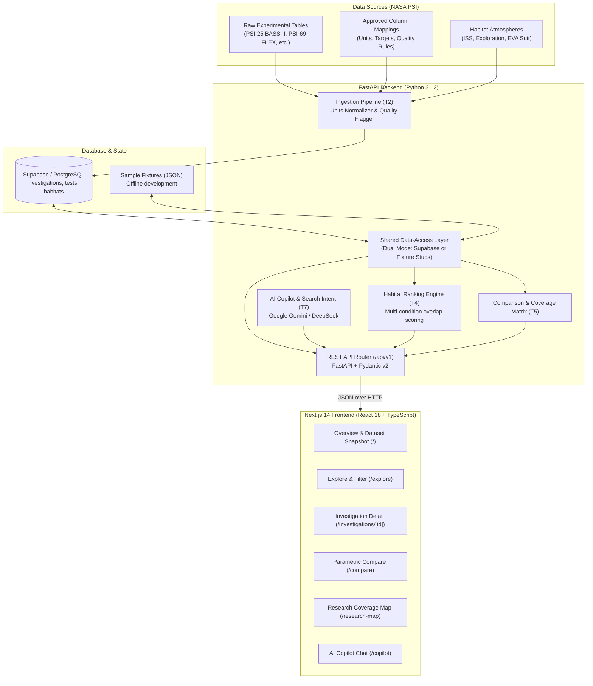

# IGNIS: Flame in Freefall
### NASA Microgravity Combustion Research Discovery & Habitat Compatibility Engine

[](https://www.spaceappschallenge.org/2026/challenges/flame-in-freefall/)
[](https://github.com/Uman-66/Nasa-Space-App-challenge.git)
[](https://fastapi.tiangolo.com/)
[](https://nextjs.org/)
[](https://www.typescriptlang.org/)
[](https://www.python.org/)
[](LICENSE)

---

## 1. What This Project Does

**IGNIS** is an open-source microgravity fire research exploration engine built for the **NASA Space Apps Challenge 2026 ("Flame in Freefall")**.

In microgravity (such as aboard the International Space Station or in lunar/Martian transit), flames behave fundamentally differently than on Earth. Without gravity-driven buoyancy (hot air rising), natural convection disappears:
- Flames burn as slow, dim, rounded spheres rather than tear-drops.
- Soot and combustion products linger around the flame zone.
- Extinction limits, airflow, and ambient oxygen concentrations drastically alter flame spread and material flammability.

NASA's **Physical Sciences Informatics (PSI)** repository contains decades of experimental tables, sensor readings, and observations from flight experiments (such as **BASS**, **BASS-II**, **FLEX**, **FLEX-2**, **ACME**, and **Saffire**). However, this data has historically been siloed across disparate experimental tables, inconsistent column formats, incompatible units, and isolated research papers.

**IGNIS solves this by:**
1. **Harmonizing Raw PSI Data:** Normalizing heterogeneous experimental tables (fuels, oxygen concentrations, pressures, flow speeds, and outcomes) into a unified, queryable schema with automated unit conversion and quality flagging.
2. **Habitat Condition Ranking (T4):** Evaluating and scoring microgravity investigations against real and proposed extraterrestrial habitat atmospheres (e.g., ISS Cabin, NASA Exploration Atmosphere 8.2 psia, Staged Cabin 10.2 psia, and EVA spacesuits).
3. **Comparative Analysis & Gap Mapping (T5):** Offering side-by-side parametric comparisons and a 2D Research Coverage Matrix that immediately highlights which fuel classes and combustion topics have been thoroughly studied versus critical gaps in the literature.
4. **Grounded AI Copilot & Search (T7):** Providing an AI assistant powered by Google AI Studio (Gemini) that answers combustion science queries **strictly citing indexed records**, detailing scientific limitations rather than hallucinating safety conclusions.
5. **Universal Export & Offline-First Dual Mode:** Operating seamlessly either against a live Supabase database or offline using pre-bundled JSON fixtures (`fixtures (sample)` mode).

> **Scientific Disclaimer:** IGNIS is a research discovery and exploration prototype. It is **not** a flight-certified safety tool, fire-prediction model, or replacement for NASA engineering safety review.

---

## 2. System Architecture



---

## 3. Key Capabilities

### 🔍 1. Investigation Explorer & Filtering (`/explore`)
- Search by keyword across titles, acronyms, summaries, hardware families, and source IDs.
- Filter by topic tag (e.g., *Material flammability*, *Flame structure*, *Oxygen & airflow effects*, *Fire suppression*), fuel class (*Solid*, *Gas*, *Liquid droplet*, *Particulate / aerosol*), platform (*ISS*, *Sounding rocket*, *Drop tower*), and measurement types.
- Case-insensitive alias matching supporting canonical IDs (`PSI-25`), aliases (`psi-25`, `psi-bass-ii`), and acronyms (`BASS-II`).

### 📊 2. Unified Test Rows & CSV Streaming Export (`/tests`, `/export/tests.csv`)
- Standardizes diverse experimental columns into unified parameters:
  - `oxygen_pct` (% by volume)
  - `pressure_kpa` (normalized to kPa from mmHg, psi, or atm)
  - `flow_cm_s` (flow velocity in cm/s)
  - `fuel`, `geometry`, `diluent`, and `outcome` (e.g., Extinction, Disruption).
- Flagging engine notes uncalibrated inputs (such as dimensionless fan dial settings) and out-of-range anomalies.
- High-performance chunked CSV export supporting full or per-investigation data downloads.

### 🪐 3. Habitat Matching & Ranking Engine (`/rank`)
Evaluates investigations against target spacecraft or planetary habitat atmospheres:
- **ISS Cabin:** 101.3 kPa (14.7 psia), 19.5%–23.1% O₂
- **Exploration Atmosphere:** 56.5 kPa (8.2 psia), 32%–36% O₂
- **Staged Cabin:** 70.3 kPa (10.2 psia), 24.5%–28.5% O₂
- **Spacesuit (EVA):** 29.6 kPa (4.3 psia), 98%–100% O₂

**Scoring Model:**
$$\text{Score} = \frac{\text{tests}_{\text{full}} + 0.5 \times \text{tests}_{\text{partial}}}{\text{tests}_{\text{total}}}$$
- **Full match:** Both oxygen and pressure fall inside the habitat specification.
- **Partial match ($0.5$):** Oxygen matches; pressure was unrecorded/unconstrained.
- **Zero ($0.0$):** Recorded parameters violate the habitat envelope.

### ⚖️ 4. Parametric Comparison & Coverage Matrix (`/compare`, `/research-map`)
- Side-by-side comparison of 2–4 selected investigations.
- Dynamic charts comparing numerical parameters (e.g., maximum/minimum O₂ concentrations, pressure spans) only when units and measurement contexts match.
- Topic $\times$ Fuel Class coverage grid identifying well-researched zones vs uninvestigated combinations.

### 🤖 5. Grounded AI Copilot (`/copilot`, `/ai/ask`, `/ai/search`)
- Natural-language search translation (e.g., *"What solid materials extinguish under 20% oxygen?"* $\rightarrow$ structured filters).
- Question-answering pipeline citing only indexed PSI records, explicitly listing limitations when data is missing.

---

## 4. Repository Structure

```text
flame-in-freefall/
├── backend/                        # FastAPI Python backend
│   ├── ai/                         # AI logic (Explain, Mapping proposal CLI)
│   ├── app/                        # Main FastAPI application
│   │   ├── analytics/              # Comparison, coverage, variable analysis
│   │   ├── ranking/                # Habitat scoring algorithms
│   │   ├── routers/                # Endpoint routers (investigations, tests, rank, etc.)
│   │   ├── config.py               # Environment configuration
│   │   ├── data_access.py          # Unified data access (Supabase / fixtures fallback)
│   │   ├── db.py                   # Supabase client manager
│   │   ├── llm.py                  # LLM connector (OpenAI-compatible / Gemini)
│   │   ├── main.py                 # FastAPI application factory & CORS setup
│   │   └── schemas.py              # Pydantic v2 data contract models
│   ├── db/schema.sql               # Database DDL schema for PostgreSQL / Supabase
│   ├── fixtures/                   # Sample JSON data for offline development
│   ├── ingest/                     # Ingestion scripts for PSI CSV tables
│   ├── scripts/                    # CLI tools (check_llm, smoke test)
│   ├── tests/                      # Pytest suite
│   ├── requirements.txt            # Python dependencies
│   └── README.md                   # Backend architecture and task breakdown
│
├── frontend/ignis-frontend/        # Next.js 14 TypeScript frontend
│   ├── src/
│   │   ├── app/                    # Next.js App Router pages
│   │   │   ├── page.tsx            # Overview & snapshot
│   │   │   ├── explore/            # Investigation search & filter
│   │   │   ├── investigations/[id]/# Deep-dive detail tabs
│   │   │   ├── compare/            # Side-by-side comparison
│   │   │   ├── research-map/       # 2D Topic x Fuel coverage matrix
│   │   │   └── copilot/            # AI Q&A panel
│   │   ├── components/             # Modular UI components (Recharts, Tailwind)
│   │   ├── context/                # Client state (CompareTray context)
│   │   ├── lib/                    # API client, types, and mock data
│   │   └── tailwind.config.ts      # Space/Flame theme design tokens
│   ├── package.json
│   └── README.md
│
├── data/                           # Experimental data & metadata
│   ├── raw/                        # Original PSI experimental CSV tables
│   ├── mappings/                   # Human-approved and AI-proposed table mappings
│   ├── habitats.json               # Extraterrestrial habitat specifications
│   └── investigations.json         # Investigation metadata registry
│
├── docs/                           # Scientific documentation
│   └── ranking.md                  # Complete mathematical formula & rationale for T4
└── README.md                       # This document
```

---

## 5. Getting Started

### Prerequisites
- **Python:** 3.10 to 3.12
- **Node.js:** 18.18+ (Node 20 LTS recommended)
- **Git**

### Clone Repository
```bash
git clone https://github.com/Uman-66/Nasa-Space-App-challenge.git
cd Nasa-Space-App-challenge
```

---

### Backend Setup

1. **Navigate to the backend directory:**
   ```bash
   cd backend
   ```

2. **Create and activate a virtual environment:**
   - **Windows (PowerShell):**
     ```powershell
     python -m venv .venv
     .venv\Scripts\Activate.ps1
     ```
   - **macOS / Linux:**
     ```bash
     python3 -m venv .venv
     source .venv/bin/activate
     ```

3. **Install dependencies:**
   ```bash
   pip install -r requirements.txt
   ```

4. **Configure environment variables:**
   Copy `.env.example` to `.env`:
   ```bash
   cp .env.example .env
   ```
   Configure your keys in `backend/.env`:
   ```env
   # Database (Supabase) — leave blank to run in offline fixtures mode
   SUPABASE_URL=https://your-project.supabase.co
   SUPABASE_KEY=your-supabase-anon-or-service-key

   # LLM (Google AI Studio Gemini API or DeepSeek)
   LLM_BASE_URL=https://generativelanguage.googleapis.com/v1beta/openai/
   LLM_MODEL=gemini-2.5-flash
   LLM_API_KEY=your-gemini-api-key

   # CORS
   CORS_ORIGINS=http://localhost:3000
   ```

5. **Start the API server:**
   ```bash
   uvicorn app.main:app --reload --port 8000
   ```
   - Interactive OpenAPI docs: [http://localhost:8000/docs](http://localhost:8000/docs)
   - Health check: [http://localhost:8000/api/v1/health](http://localhost:8000/api/v1/health)

6. **Run the test suite:**
   ```bash
   python -m pytest -q
   ```

---

### Frontend Setup

1. **Navigate to the frontend directory:**
   ```bash
   cd frontend/ignis-frontend
   ```

2. **Install dependencies:**
   ```bash
   npm install
   ```

3. **Configure environment:**
   ```bash
   cp .env.example .env.local
   ```
   To connect to the local FastAPI backend, set:
   ```env
   NEXT_PUBLIC_USE_MOCK=false
   NEXT_PUBLIC_API_BASE_URL=http://localhost:8000/api/v1
   ```
   *(Leaving `NEXT_PUBLIC_USE_MOCK=true` allows the frontend to run entirely standalone with zero backend dependencies).*

4. **Start the Next.js development server:**
   ```bash
   npm run dev
   ```
   Open [http://localhost:3000](http://localhost:3000) in your browser.

---

## 6. API Reference (`/api/v1`)

| Method | Endpoint | Query / Body | Description | Header |
|---|---|---|---|---|
| `GET` | `/health` | — | System health check | — |
| `GET` | `/dashboard/summary` | — | Total counts of investigations, tests, habitats, files, and topic breakdown | `X-Data-Source` |
| `GET` | `/filters` | — | Available topic tags, fuel classes, platforms, and measurement options | — |
| `GET` | `/investigations` | `q`, `hardware_family`, `page`, `page_size` | Paginated investigation search | `X-Data-Source` |
| `GET` | `/investigations/{id}` | — | Single investigation details (accepts `PSI-25`, `BASS-II`, etc.) | `X-Data-Source` |
| `GET` | `/investigations/{id}/variables`| — | Varied vs constant parameter analysis for test rows | `X-Data-Source` |
| `GET` | `/tests` | `investigation_id`, `fuel`, `outcome`, `min_oxygen`, `max_oxygen`, `min_pressure_kpa`, `max_pressure_kpa`, `page`, `page_size` | Paginated raw test conditions | `X-Data-Source` |
| `GET` | `/tests/{id}` | — | Detail of a single test run (URL-encoded ID) | `X-Data-Source` |
| `GET` | `/habitats` | — | Atmospheric profiles of spacecraft & extraterrestrial habitats | `X-Data-Source` |
| `GET` | `/rank` | `habitat=<habitat_id>` | Scores investigations for compatibility with a specific habitat | `X-Data-Source` |
| `POST`| `/compare` | `{"investigation_ids": ["PSI-25", "PSI-69"]}` | Side-by-side parametric matrix for 2–4 records | `X-Data-Source` |
| `GET` | `/analytics/coverage` | — | Topic $\times$ Fuel Class coverage matrix | — |
| `GET` | `/export/tests.csv` | `investigation_id` (optional) | Streamed CSV download of test conditions | `X-Data-Source` |
| `POST`| `/ai/search` | `{"question": "..."}` | Converts plain natural language into structured search parameters | — |
| `POST`| `/ai/ask` | `{"question": "...", "investigation_ids": [...]}` | Grounded Q&A citing selected records with source links | — |

---

## 7. Dual-Mode Data Source Transparency

To guarantee scientific transparency, IGNIS clearly identifies whether data is live or simulated via the `X-Data-Source` HTTP response header:
- `X-Data-Source: supabase` $\rightarrow$ Live data fetched from verified database records.
- `X-Data-Source: fixtures (sample)` $\rightarrow$ Fallback demo data served from local JSON fixtures.
- If live credentials are provided but the database fails, endpoints return **HTTP 503 Service Unavailable** rather than quietly returning stale sample data as real records.

---

## 8. Automated Smoke Verification

A dedicated end-to-end smoke verification script is included to test all endpoints:

```bash
cd backend
python -m scripts.smoke --base-url http://localhost:8000
```
This tests every route under both live and sample modes, reporting exact response times, HTTP statuses, and header contracts.

---

## 9. Contributors & Acknowledgments

- **NASA Space Apps Challenge 2026:** ["Flame in Freefall" Challenge Team](https://www.spaceappschallenge.org/2026/challenges/flame-in-freefall/)
- **Data Source:** [NASA Physical Sciences Informatics (PSI) System](https://psi.nasa.gov/)
- Built with NASA open data, Next.js, and FastAPI.
